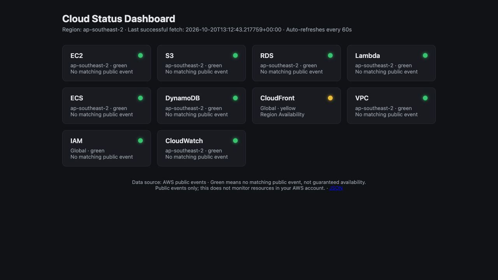
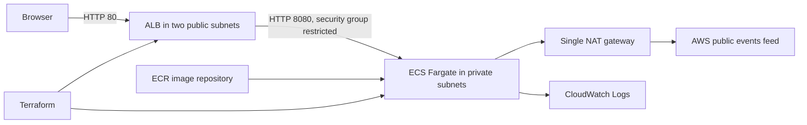

# Cloud Status Dashboard

A personal cloud engineering project using Python/FastAPI and Terraform to deploy a status dashboard on AWS ECS Fargate. The project includes container builds, image publishing, deployment verification and GitHub Actions CI.

The application summarises public AWS events for selected Sydney services and global IAM/CloudFront. It uses the public event feed and does not inspect account-specific resources. The infrastructure is sized for a small demonstration environment.



## Architecture



Defaults: `ap-southeast-2`, one Linux/X86_64 task, 0.25 vCPU, 512 MiB, two public/private subnet pairs, one NAT gateway and fourteen-day log retention. Only the ALB is publicly reachable. The app's task role has no AWS API permissions; its execution role permits image pulls and log delivery.

## Features

- Terraform provisioning for VPC networking, security groups, IAM, ECR, ALB, ECS and logs.
- An explicit amd64 Docker build running as a non-root user.
- Scripted image publishing and deployment, with Terraform plan review before applying changes.
- Unique immutable image tags, ECS circuit-breaker rollback and post-deployment verification.
- CI validation, application tests, deployment-script tests with stub CLIs, container build and route checks.

GitHub Actions performs CI only. Deployment runs from `deploy.sh` using the operator's AWS credentials. No GitHub AWS secrets are required by CI.

## Public event semantics

- `GET /` displays status cards and refreshes every 60 seconds.
- `GET /api/status` returns `region`, request time (`checked_at`), `last_success_at`, `data_state`, `error` and `services`.
- `GET /health` returns `{"status":"healthy"}` for ALB liveness, independent of the external feed.
- Green means **no matching public event**, not guaranteed availability. Yellow means a matching informational, degraded or resolved event; red means a matching disrupted event. Unknown status codes remain unknown.
- The current feed redirects from `status.aws.amazon.com/data.json` to `health.aws.amazon.com/public/currentevents` and uses UTF-16 JSON. The app follows redirects and decodes JSON bytes.
- Matching uses exact service identifiers, including individual entries under multi-service incidents. IAM and CloudFront are global.
- On fetch/schema failure, all current indicators become unknown. The API distinguishes `unavailable` from `stale`, and preserves the last successful fetch time. Successful and failed fetch attempts are cached for 60 seconds to limit upstream requests.

The public feed may change format and does not provide account-specific resource health. See [AWS public dashboard guidance](https://docs.aws.amazon.com/health/latest/ug/aws-health-dashboard-status.html).

## Run and test locally

Prerequisites: Python 3.12, Docker Desktop/Engine for container checks, Terraform >= 1.5, AWS CLI v2 for deployment. CI uses Terraform 1.7.5. The provider lock file is committed for repeatable provider selection.

```bash
python3.12 -m venv .venv
source .venv/bin/activate
python -m pip install -r app/requirements-dev.txt
cd app
python -m pytest -q tests ../tests
python -m uvicorn app:app --host 127.0.0.1 --port 8080
```

Open `http://localhost:8080`. To use Docker instead, stop the local server and run these commands from the project root:

```bash
docker build --platform linux/amd64 -t cloud-status:local app/
docker run --rm -p 8080:8080 cloud-status:local
```

## Deploy to your AWS account

Use a dedicated demo account or profile with permission to manage the resources above and pass the ECS IAM roles. Do not put access keys in source code. Prefer AWS IAM Identity Center/SSO or another source of temporary credentials.

```bash
export AWS_PROFILE=your-demo-profile
# If this is an SSO profile:
aws sso login --profile "$AWS_PROFILE"
aws sts get-caller-identity
export EXPECTED_AWS_ACCOUNT_ID=123456789012  # replace with YOUR verified account ID
./deploy.sh
```

On the first deployment, the script asks you to review an ECR-only Terraform apply. It then builds and uploads the image **before** the full infrastructure apply, which also requires review. This one-time targeted apply bootstraps the image repository; normal deployments use a full apply.

The script derives the ECR URL/region from Terraform outputs, prints the account and image tag, waits for ECS stability, rejects a rollback to a different task definition, and checks `/health`, `/` and live feed data at `/api/status`. It prints `Deployment verified` only if these checks pass. If the external feed is unavailable, the final check fails even if the application is healthy; inspect the API before deciding whether to retry.

Docker must be running. The deployment defaults to Sydney; if changing region, also update the `azs` Terraform variable. Build/push failures can leave the bootstrap ECR repository; rerun after resolving the error or destroy it.

## Updates and rollback

A normal `./deploy.sh` builds a timestamp-tagged image and creates a matching task-definition revision. Record the printed tag. To reapply infrastructure changes without rebuilding, or roll back to a retained image:

```bash
IMAGE_TAG="existing-image-tag" ./deploy.sh --skip-build
```

Replace the example with an actual ECR tag from your deployment. Keep `IMAGE_TAG` when applying future changes; a bare manual `terraform apply` uses the variable default and can select an unintended tag. ECR retains the last ten images. The initial deployment has no previously healthy version for the circuit breaker to restore.

## Terraform state and cleanup

This single-operator demo uses local state. Keep `terraform/terraform.tfstate` and its backup secure; never commit them. Always deploy and destroy from the same checkout with the same account/profile. Losing state can leave resources you must import or remove manually. Only the provider lock file is committed. A shared production workflow would require a secured remote backend with locking and a controlled deployment process.

```bash
./deploy.sh destroy
```

Review the destroy plan before confirming. **The demo ECR repository has `force_delete = true`; destruction deletes its images as well.** Confirm that ECS, ALB, NAT gateway, Elastic IP, ECR and logs have been removed, including after any partial deployment. See [deployment checks](docs/DEPLOYMENT.md).

## Cost and design tradeoffs

NAT gateway, ALB, Fargate, public IPv4 addresses, storage and data transfer can incur charges. This is not a free-tier-only project. Review current [AWS pricing](https://aws.amazon.com/pricing/) for Sydney, set a budget notification and destroy the demo after recording evidence. A budget notification does not automatically stop resources.

One task and one NAT keep the demo smaller but provide no multi-AZ application availability. HTTP avoids domain/certificate setup for this demo; HTTPS would be a next step for sustained public use. There is no account-resource monitoring, autoscaling or production CD pipeline. These features can be added if the deployment requirements change.

## Deployment records

The initial deployment was verified on 21 October 2026 (Melbourne time; 20 October UTC) in `ap-southeast-2`.

- Image tag: `20261020T130227Z`.
- ECS task definition revision: `cloud-status-task:1`.
- Deployment script: service-stability, expected-task-definition and HTTP checks passed.
- Endpoint verification: `/`, `/health` and `/api/status` returned HTTP 200; the API reported `data_state: ok` and ten services.
- ECS runtime check: `ACTIVE`, desired/running count `1`, pending count `0`.
- CloudWatch log stream confirmed for `cloud-status-app`.
- Infrastructure update: log retention changed from 7 to 14 days in place; Terraform reported zero additions, one change and zero deletions.
- After the update, deployment verification passed with the same image tag and task-definition revision. AWS CLI confirmed `retentionInDays: 14`.

- Cleanup: Terraform reported all 28 managed resources destroyed. Follow-up checks confirmed an empty Terraform state and no remaining project VPC, NAT gateway, Elastic IP, ALB, target group, active ECS cluster, ECR repository, CloudWatch log group or IAM roles.

The screenshot above was captured while the application was running. The AWS environment has since been removed to avoid ongoing resource charges. See the [deployment checklist](docs/DEPLOYMENT.md) to reproduce the deployment.
